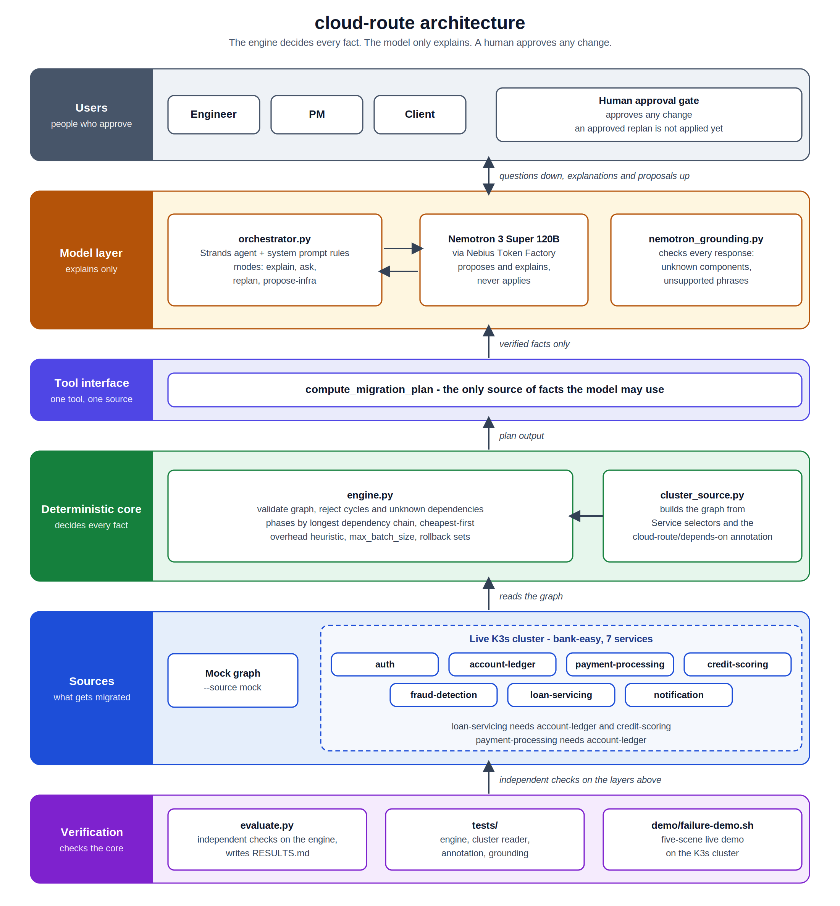

# cloud-route

**A deterministic planner for the safe order of a cloud migration, with an LLM agent that is only allowed to explain.**

Moving interdependent services in the wrong order breaks things. cloud-route reads a live
Kubernetes (K3s) cluster, builds the dependency graph, and computes the migration plan in
ordinary code: phases, cost order, batch limits, rollback sets, data-residency flags, security
findings and right-sizing suggestions. An NVIDIA Nemotron model, served through Nebius Token
Factory, restates those results for an engineer, a PM or a client and answers follow-up
questions. **The model never decides, never invents, and never applies a change.** A person
applies any change.

Built for the Nebius x NVIDIA Global AI Hackathon (AI apps and agents).
Model: `nvidia/nemotron-3-super-120b-a12b`.

> **Why this design?** Asked for a migration order directly, the same model returned a complete,
> dependency-safe plan for 43 of 55 graphs, and its four wrong plans carried no warning. The
> engine passed all 55 under the same checker. So the engine decides, and the model explains.
> Details are in [Evaluation](#evaluation).

## Contents

- [The problem](#the-problem)
- [How it works](#how-it-works)
- [What the engine computes](#what-the-engine-computes)
- [The agent and how it is kept honest](#the-agent-and-how-it-is-kept-honest)
- [Demo app: bank-easy](#demo-app-bank-easy)
- [Evaluation](#evaluation)
- [Quick start](#quick-start)
- [Usage](#usage)
- [Reproducing the results](#reproducing-the-results)
- [Status](#status)
- [Limits and known issues](#limits-and-known-issues)
- [Repo layout](#repo-layout)

## The problem

- **Sequencing risk.** If service A calls service B, B must be ready first, and anything that
  depends on several services must wait for all of them. Most pre-deployment checks look at one
  change at a time, not at a whole migration plan.
- **Communication risk.** A correct plan is useless if the people who approve it cannot follow
  it. Engineers, PMs and clients each need a different view of the same facts.
- **Cost and blast-radius risk.** Components get double-billed across old and new environments
  for longer than needed, and one failure can trigger an all-or-nothing rollback.
- **Trust risk.** A fluent LLM explanation can state things the plan does not support, and a
  wrong plan reads exactly like a right one.

## How it works

1. `agent/cluster_source.py` reads the live K3s cluster and builds a dependency graph.
   Dependencies come from Service selectors and from an explicit annotation,
   `cloud-route/depends-on`, on a Deployment or StatefulSet (a call made through an
   environment variable is invisible to the cluster's object graph).
2. `agent/engine.py` validates the graph and orders it into safe phases. A cycle is an error,
   not silently broken, and so is a dependency on a component that does not exist.
3. `agent/orchestrator.py` is a Strands agent with five tools. Their output is the only source
   of facts the model may use. For anything else it says "the tool does not provide that".
4. After every response a grounding scan prints a `[grounding warning]` for anything no tool
   returned.

## What the engine computes

| Module | What it does |
|---|---|
| **Plan** | Topological generations become phases: no component in a phase depends on another in the same phase. Cheaper components go first within a phase. An optional per-phase cap (`max_batch_size`) splits a phase into chunks. Reports a delay-overhead heuristic. |
| **Rollback** | For any component, the components that depend on it and must be undone first. |
| **Residency** | Reads a declared `cloud-route/region` annotation. Lists components outside the allowed regions, dependencies that cross regions, and components with no region. A component with no region is never treated as compliant. Regions are declared, not discovered. |
| **Security scan** | Five checks on every Deployment and StatefulSet: no CPU or memory limit, image with no tag or the `latest` tag, a secret-looking environment variable with its value in the manifest, privileged mode, and a container that may run as root. Only variable names are ever printed, never values. |
| **Right-sizing** | Reads usage from the Kubernetes metrics API and suggests `max(floor, round_up(usage x 1.5, step))` using exact fractions. It only suggests. The headroom, floors and step are policy parameters, and one snapshot is not peak usage. |
| **Failure-mode notes** | Twelve short guidance notes, searched with hybrid BM25 + Qwen3-Embedding-8B retrieval (reciprocal-rank fusion, a similarity floor, BM25 fallback). Notes are printed verbatim by code. |

## The agent and how it is kept honest

The agent has four modes:

- **explain**: the plan in plain language, in a style for an engineer, a PM or a client
- **ask**: answers a question using only tool output (for example, why a service is in the
  last phase, or what fails if a given service goes down)
- **replan**: proposes a change to `max_batch_size` when a priority changes. Approving it
  recomputes the capped plan; nothing is applied to the cluster.
- **propose-infra**: drafts a new infrastructure request, clearly labeled as a draft

None of them applies anything. Every mode proposes or explains, and a human acts.

How the model is kept honest:

- Facts come only from the tools, and the tools carry the only permitted definitions of the
  overhead number and the ordering.
- The system prompt forbids invented components, per-component costs, causes for the overhead
  figure, claims about how components in a phase execute, and unrequested advice.
- Failure-mode notes are printed verbatim by code. The model adds only a short framing. (Two
  rounds of prompt wording alone were not enough, so this is enforced in code.)
- Retrieval searches with the user's own question, not the model's shortened version of it.
- A post-hoc grounding scan warns when a response names a component, a number, a phase count,
  a dependency, a phrase or a note id that no tool returned. It checks wording against tool
  output; it is a safeguard, not a proof.

## Demo app: bank-easy

A small banking system of seven services (Node/Express), containerized and deployed to K3s, so
the agent sequences a real system and not synthetic data.

| Service | Port | Depends on |
|---|---|---|
| auth | 4001 | none |
| account-ledger | 4002 | none |
| payment-processing | 4003 | account-ledger |
| credit-scoring | 4004 | none |
| fraud-detection | 4005 | none |
| loan-servicing | 4006 | account-ledger, credit-scoring |
| notification | 4007 | none |

Loan-servicing is the service that breaks if the order is wrong. It cannot approve or pay out
a loan without the ledger and credit scoring.

### Failure demo

    ./demo/failure-demo.sh

Five scenes on the live cluster:

1. The plan cloud-route computes for the cluster.
2. A customer asks for a loan and it succeeds.
3. Credit-scoring is taken down, as if migrated too early, and the same request fails with
   "credit-scoring unreachable".
4. Credit-scoring comes back and loans work again.
5. The agent explains why loan-servicing has to wait for the services it depends on
   (needs `NEBIUS_API_KEY`).

Residency scene (four Deployments labeled by hand for the demonstration):

    python -m agent.orchestrator --source k3s --residency "eu-west-1"

It flags `payment-processing` (us-east-1) as outside eu-west-1 and its dependency on
`account-ledger` (eu-west-1) as crossing regions.

## Evaluation

The engine decides the order, so the engine is what is evaluated. Every expected answer is
computed by a route separate from the code under test (integers, plain Python, or a
hand-built graph). Because a check that cannot fail proves nothing, each evaluator is also run
against deliberately broken versions of the code (mutants) and must catch them.

| What | Result |
|---|---|
| Engine, 70-component bank dataset (128 dependencies, 7 phases) | all 8 checks pass |
| Engine, live K3s cluster (14 components, 10 dependencies, 3 phases) | all checks pass |
| 550 generated graphs (11 shapes x 50 seeds, about 5 to 200 components) | 550/550 |
| Residency, 200 random graphs plus the dataset | 200/200, 5 broken versions caught |
| Right-sizing, 7 checks | 8,100 cases pass, 4 broken versions caught |
| Security scan, 2,000 random pods from planted faults | 2,000/2,000, **13/13** broken copies caught |
| Security scan vs Checkov 3.3.30 on the same manifest | agree on all five shared rules; Checkov fails 15 further rules the scan does not cover |
| Retrieval, 28 hand-written questions | hybrid finds the right note first for 12/12 plain and 8/12 paraphrased questions (BM25 alone: 4/12), MRR 0.85 |
| Test suite | 337 tests pass |

### Against the same model without tools

55 generated graphs, the same checker for both:

| | LLM only | Engine |
|---|---|---|
| Complete and dependency-safe | 43/55 (46/55 with a step-by-step prompt) | 55/55 |
| Cut off at the 30,000-token limit | 8 | n/a |
| Finished but wrong, with no warning | 4 | 0 |

This is a small test (one model, two prompts, one run per graph). It does not show that LLMs
cannot order dependencies; it shows the answer comes with no guarantee.

### Against a plain topological sort

With no batch cap the two give the same phases and the same overhead on all 550 graphs, since
ordering by generations is classical. With a cap, the engine's overhead was never higher and
was strictly lower on 479/550 graphs at cap 2 (12.4% lower on average when lower) and 461/550
at cap 3 (12.0%). These use the engine's own heuristic, which is not a measured cost.

### Grounding

- 48 real agent responses (16 items x 3 runs), labeled by hand: **0** contained an unsupported
  fact. The original scan raised **5 false alarms** (concurrency wording such as "at the same
  time").
- Because no response was bad, a **planted-fault test** put one known fault into each of 43
  responses. The original scan caught only the kinds it was built for. Four added checks
  (lowercase names, numbers no tool returned, phase-count claims, dependency claims) caught
  four more kinds at 43/43. Two kinds are still missed (a single capitalized invented word,
  and a claim not on the phrase list). The added checks raised no false alarms on the 48 real
  responses, but they were revised on those same responses, so that figure is in-sample.

### Findings about our own work

The evaluation found flaws in this project, and they are kept in the record:

- A written claim that a smaller batch cap never lowers overhead was false (33 of 550 graphs).
  The code, tests and docs now state only what holds.
- A mutant that removed the right-sizing floor escaped the first checker, and a security-scan
  mutant (`valueFrom` treated as a secret) escaped the first evaluator. In both, the random
  data never exercised that branch. Adding the case fixed both.
- The model's shortened search query dropped the words that pointed to the right note.
- The first version of the added grounding checks flagged true dependency and phase-count
  statements. They now compare against the tool's own dependency map.

## Quick start

Prerequisites: Python 3.10+, Node 20, Docker, K3s, and a Nebius Token Factory API key.

    git clone https://github.com/SuchithraChandrasekaran/cloud-route
    cd cloud-route
    python3 -m venv .venv
    source .venv/bin/activate
    pip install -r requirements.txt
    python -m pytest tests/ -q

Build the bank-easy images, load them into K3s and deploy:

    cd bank-easy
    for entry in auth-service:auth account-ledger-service:account-ledger payment-processing-service:payment-processing credit-scoring-service:credit-scoring fraud-detection-service:fraud-detection loan-servicing-service:loan-servicing notification-service:notification; do
      docker build -q -t bank-easy/${entry##*:}:v1 ${entry%%:*}
      docker save bank-easy/${entry##*:}:v1 | sudo k3s ctr images import -
    done
    cd ..
    sudo k3s kubectl apply -f k8s/bank-easy.yaml

Let the Python client reach the cluster. K3s keeps its login file where only root can read it,
so copy it to your own folder once:

    mkdir -p ~/.kube
    sudo cp /etc/rancher/k3s/k3s.yaml ~/.kube/config
    sudo chown $USER:$USER ~/.kube/config
    chmod 600 ~/.kube/config

Use `--source mock` in any command below to run against a small built-in graph without a
cluster.

## Usage

Plan the migration (no API key needed):

    python -m agent.orchestrator --source k3s

Explain, ask, re-plan and propose (needs a Nebius key):

    export NEBIUS_API_KEY=your_key_here
    python -m agent.orchestrator --source k3s --explain engineer
    python -m agent.orchestrator --source k3s --explain client
    python -m agent.orchestrator --source k3s --ask "why is loan-servicing in the last phase?"
    python -m agent.orchestrator --source k3s --replan "prioritize downtime over cost"
    python -m agent.orchestrator --source k3s --propose-infra "a staging database connected to monitoring"
    python -m agent.orchestrator --source k3s --residency "eu-west-1"

Rollback, security, right-sizing and failure-mode lookup are agent tools, so you can reach
them by asking. Run `python -m agent.orchestrator --help` for the full list of options.

> Keep your API key out of git. Export it in your shell; never put it in a file in the repo.

## Reproducing the results

    python -m pytest tests/ -q                                   # unit tests
    python -m agent.evaluate --source both --write RESULTS.md    # engine, dataset + live cluster
    python -m agent.evaluate_generated --write RESULTS_GENERATED.md   # 550 generated graphs
    python -m agent.grounding_seeded_faults --write results/RESULTS_GROUNDING_SEEDED.md   # planted-fault test

The grounding study and the LLM-only baselines call the Nebius API, so they need a key and
cost tokens. Their run logs and hand labels are kept in the repo (`grounding_runs.jsonl`,
`grounding_labels.jsonl`) so the scoring can be repeated without new API calls. Written-up
results are in `results/` and the `RESULTS*.md` files.

## Status

Working now:

- Deterministic engine with phases, cost order, batch caps and rollback sets
- Live K3s graph extraction, including the dependency and region annotations
- Residency flagging, a five-rule security scan and right-sizing from the metrics API
- Hybrid retrieval over twelve failure-mode notes, with BM25 fallback
- All four agent modes against the live cluster, with explain styles for three audiences
- Grounding scan with the four added checks
- Independent evaluators with mutants for every module, 550 generated graphs, and baselines
  against the same model without tools, a plain topological sort and Checkov
- Seven bank-easy services, containerized, deployed, and a scripted failure demo

By design, not built: applying a change to the cluster. cloud-route only plans, explains and
proposes.

Future work only: discovering dependencies from environment variables or a service mesh/eBPF,
multi-snapshot right-sizing, Prometheus time series, entailment gating of explanations, and a
vector database with a reranker.

## Limits and known issues

- **Dependencies are inferred.** They come from Service selectors and the
  `cloud-route/depends-on` annotation. A dependency in neither is invisible to the engine.
- **Residency is declared, not discovered.** The check tests the engine's logic on labels; it
  does not show that any data sits in a region.
- **Cost is a proxy.** Cost order and the overhead figure are built from requested CPU and
  memory, not a cloud bill. All seven bank-easy Deployments request the same resources, so on
  the live cluster the order inside a phase is a tie. The overhead heuristic is not validated
  against real migration costs and is used only to compare batch caps.
- **The security scan is narrow.** Five rules, no image vulnerability scanning, no network
  policy or access control. A workload with no findings has passed five checks and nothing more.
- **Right-sizing uses one snapshot.** Its headroom, floors and step are policy choices, and it
  was cross-checked live on one cluster with a synthetic load.
- **The grounding scan is coarse.** It cannot judge whether a sentence is a fair paraphrase,
  and its phrase list ignores context. The explanations are checked, not guaranteed.
- **Small, synthetic and one author.** Most results are on one demonstration application and
  synthetic graphs. The evaluators and the engine share one author, so a shared misreading of
  a rule would pass both.

More detail on issues found during live runs is in `docs/ISSUES.md`.

## Repo layout

    agent/         engine, cluster reader, the Nemotron agent, grounding checks, security scan,
                   right-sizing, retrieval, and the evaluators
    bank-easy/     the seven demo services, each with a Dockerfile
    k8s/           Kubernetes manifests for bank-easy
    demo/          the scripted failure demo
    docs/          known issues
    results/       evaluation results
    tests/         unit tests
    RESULTS.md     engine evaluation results
    daily-logs/    build log
